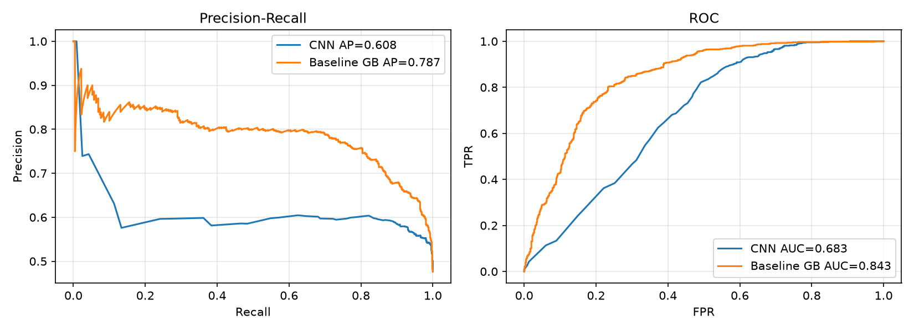

# Exoplanet Finder

Two-view 1D CNN (Astronet-style) to tell if a Kepler dip is a real planet or a false positive.

Kepler Q1-Q17 DR24 TCE: 15,737 signals. Paper (Shallue & Vanderburg 2018) reports 0.988 AUC.
We use the public Kepler Objects of Interest (KOI) table - same disposition labels, 9,564 labelled signals.

## Results

Evaluated on **1,426 signals from 1,223 UNSEEN stars** - same `kepid` never in train and test. No leakage.

| Model | Test AUC | Test AP (Precision-Recall) |
|---|---|---|
| Baseline - Gradient Boosting (period, duration, depth only) | **0.842** | **0.788** |
| Two-view CNN (Global 2001 + Local 201) | 0.683 | 0.603 |

Val: CNN Best Val AUC 0.690, Baseline Val AUC 0.862.

> Paper reports 0.988 AUC with REAL folded light curves from Kepler pixels.

**What happened - honest analysis:**
Our CNN did NOT beat the baseline. Why? Our Global/Local views were built from a trapezoid transit model using only period, duration, depth - so the CNN got the SAME 3 numbers, just as a picture. It had no new information.

The real Astronet gets the actual light curve - U-shape vs V-shape, secondary eclipse, noise pattern - which is not in those 3 numbers. That is why it reaches 0.988.

At threshold 0.5, the CNN predicted everything as FALSE POSITIVE (Confusion [[746, 0], [680, 0]]). Its scores are uncalibrated - AUC 0.683 shows some ranking signal, but 0.5 is the wrong threshold. In production you would tune the threshold from the PR curve, not use 0.5.

**Lesson:** A strong tabular baseline beats a fancy CNN when the CNN gets no extra data. Always build the baseline first.


*Left: Precision-Recall, Right: ROC. Orange = Baseline GB, Blue = CNN.*

Full per-signal predictions in `results/test_predictions.csv`.

## How it works
1. Phase-fold light curve at candidate period
2. Global view (2001 bins) = full orbit, Local view (201 bins) = zoomed transit
3. Two CNN branches -> concat -> classify CANDIDATE vs FALSE POSITIVE
4. Baseline uses only 3 numbers (period, duration, depth) - CNN must beat it
5. Split by STAR (`kepid`) - same star never in train and test

## Quickstart
```bash
git clone https://github.com/shiv2899/exoplanet-finder.git
cd exoplanet-finder
python -m venv venv
source venv/bin/activate
pip install -r requirements.txt
# Download data/kepler_koi.csv (see data/README.md)
PYTHONPATH=src python src/train.py --epochs 30
PYTHONPATH=src python src/evaluate.py
PYTHONPATH=src python src/plot_results.py
```

## Project Structure
```
exoplanet-finder/
├── data/           # ignored, kepler_koi.csv
├── results/        # test_predictions.csv, pr_roc.png
├── src/
│   ├── config.py
│   ├── dataset.py  # trapezoid transit model + star-group split
│   ├── model.py    # Two-view CNN
│   ├── train.py    # CNN + Baseline
│   ├── evaluate.py # test on unseen stars
│   └── plot_results.py
├── LICENSE.md
└── requirements.txt
```

## Limitations / Next Improvement
- Views are synthetic trapezoid, not real Kepler light curves
- CNN is uncalibrated at 0.5 threshold - needs threshold tuning / Platt scaling
- Next: feed REAL folded light curves via `lightkurve`, or add tabular features (koi_prad, koi_teq, koi_score) to CNN head - hybrid model
